# Directorio Dolorense 

App en Flutter, hecha con **TDD**, que consume una **API REST local hecha en Node**. Es un directorio de negocios de Dolores Hidalgo: la API guarda la lista y la app la **consulta, agrega, marca favoritos y elimina**. Todo funciona en la red Wi-Fi, sin pagar servidores.

### API en Node

**C1 · `responder()`: siempre JSON + cabeceras CORS**
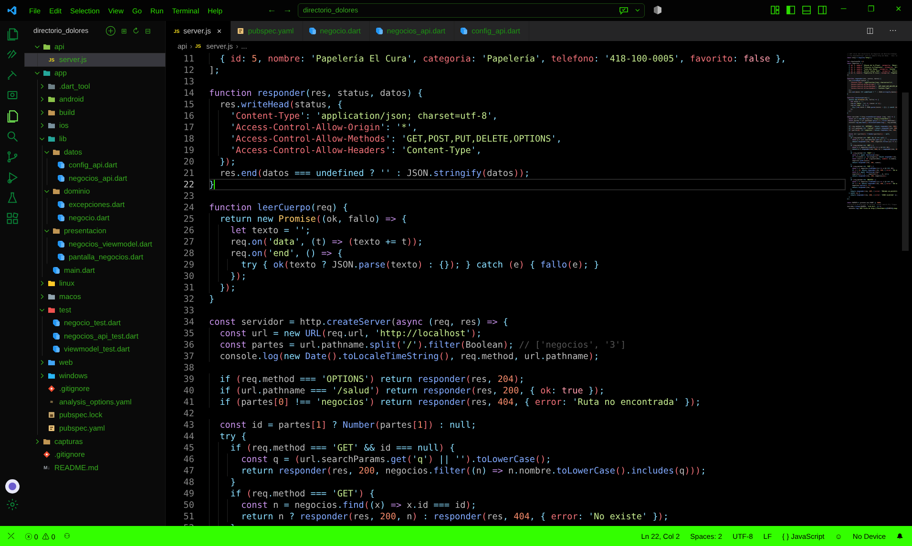

**C2 · Las rutas REST: GET, POST, PUT y DELETE con sus códigos**
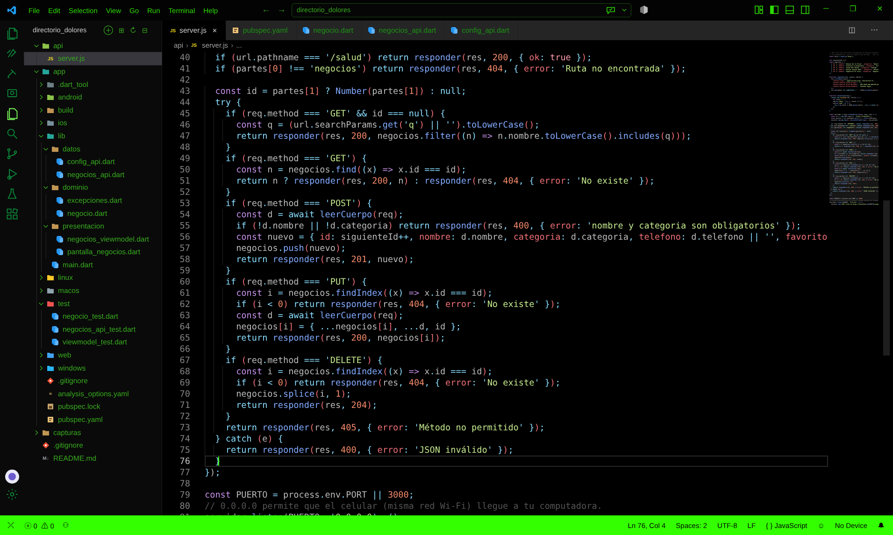

**C3 · Escuchar en `0.0.0.0` para que entre el celular**
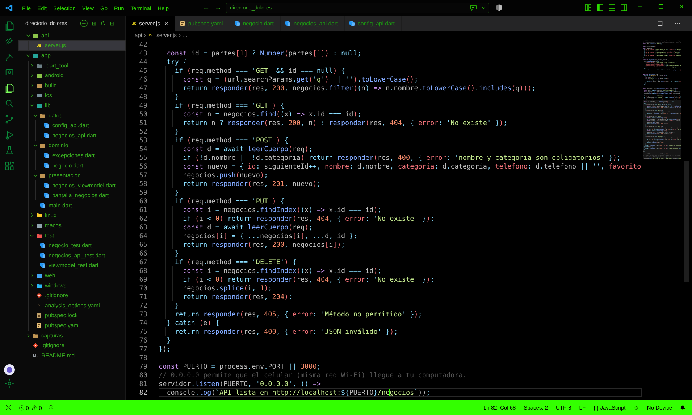

### App Flutter

**C4 · `pubspec.yaml`: se agrega el paquete http**
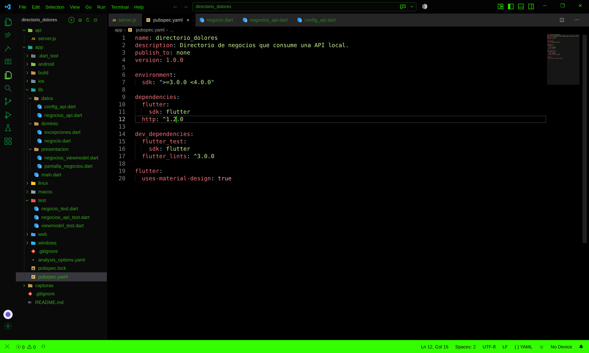

**C5 · Traductor JSON ↔ objeto `Negocio`**
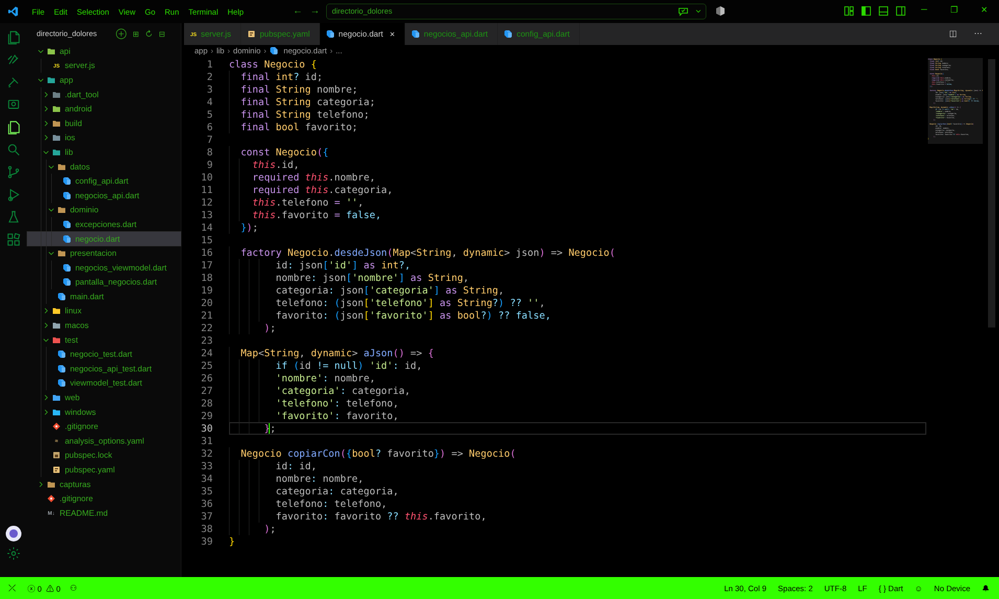

**C6 · Excepciones con nombre propio y mensaje claro**
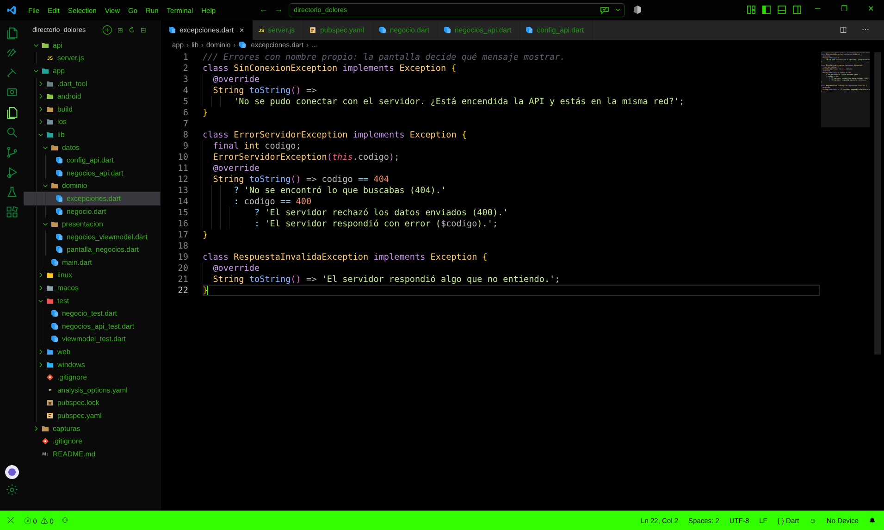

**C7 · `_ejecutar()`: timeout, errores de red y statusCode en un solo lugar**
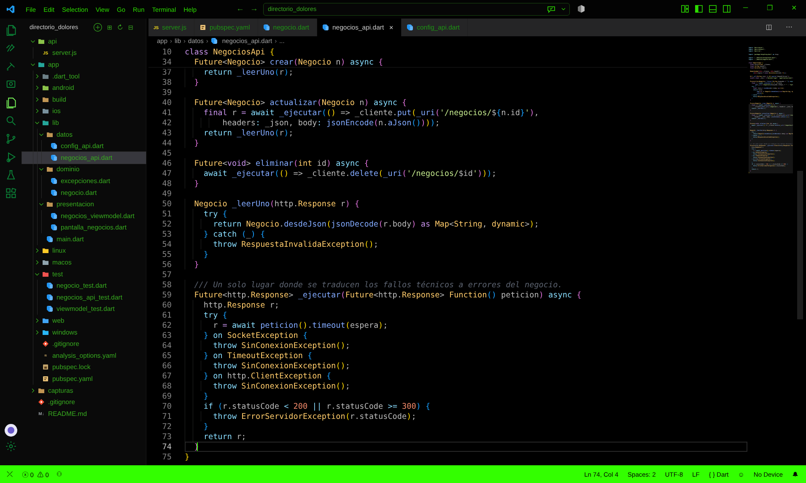

**C8 · `listar()`: GET /negocios y JSON → lista de objetos**
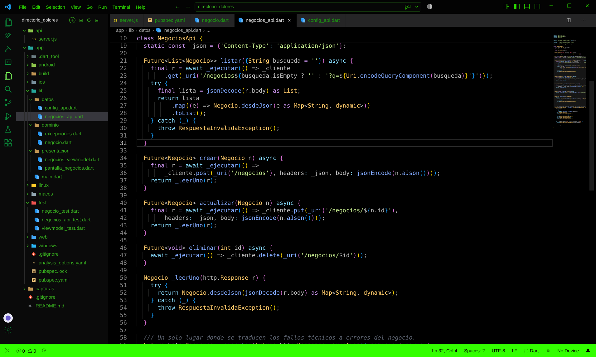

**C9 · URL según la plataforma (10.0.2.2, localhost o la IP de la PC)**
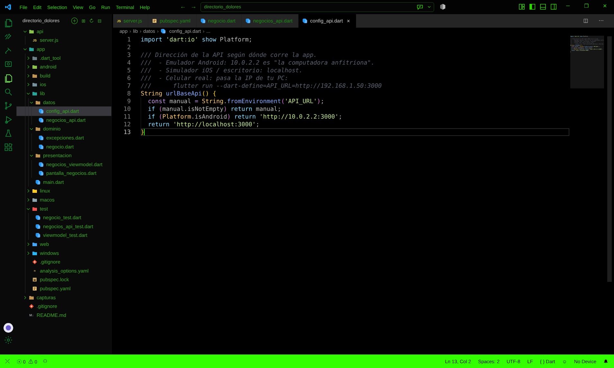

**C11 · Los 5 estados de la pantalla**
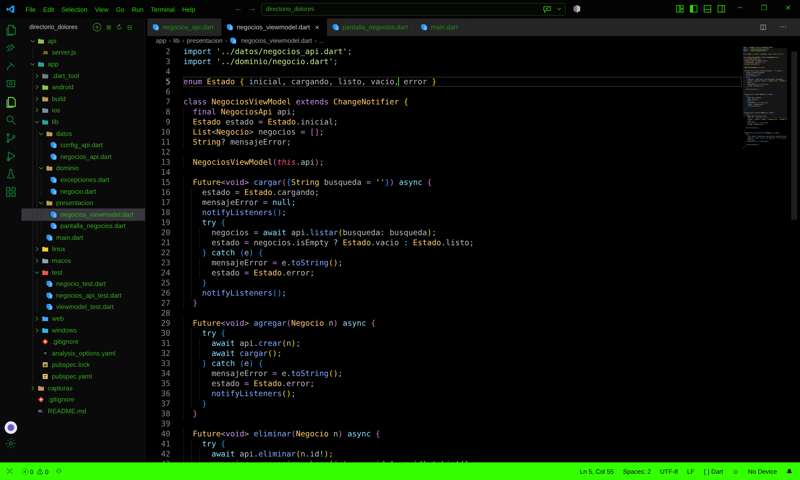

**C12 · `cargar()`: cargando → listo / vacío / error**
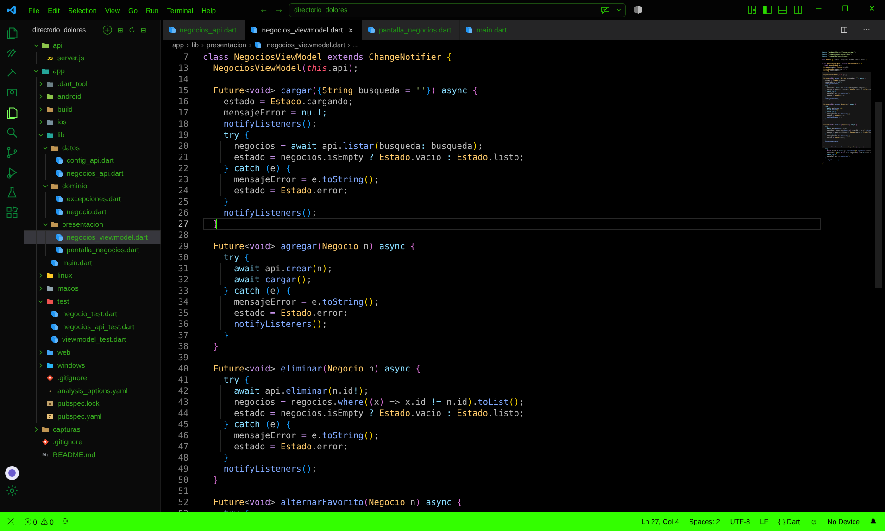

**C13 · La pantalla dibuja cada uno de los 5 estados con `switch`**
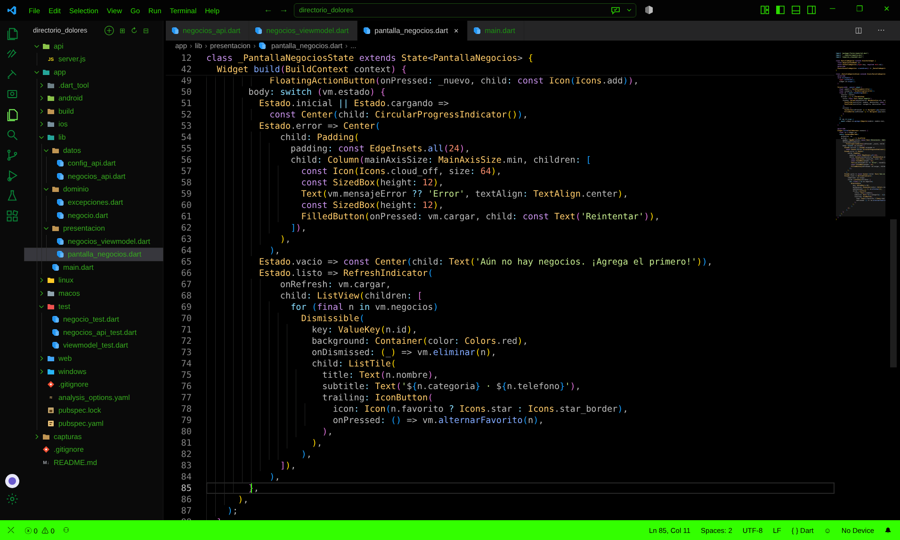

**P1 · MockClient revisa el método, la ruta y la respuesta**
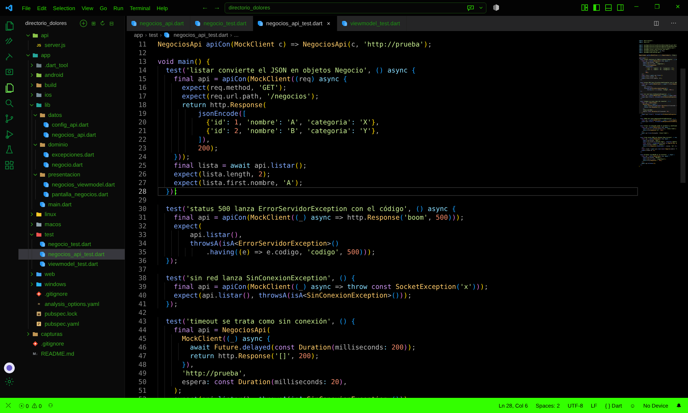

**P2 · Un servidor lento se trata como "sin conexión"**
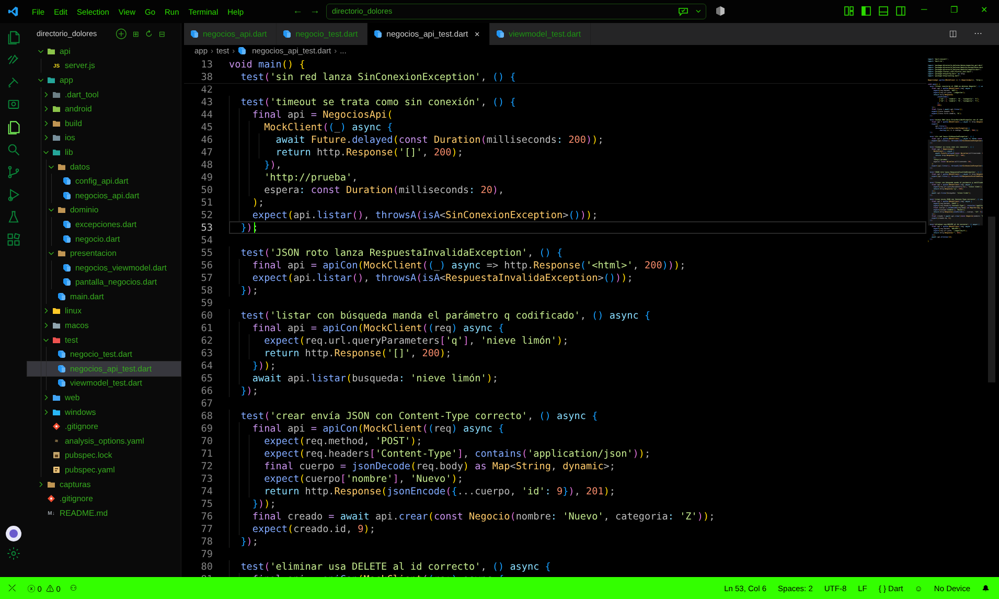

---

