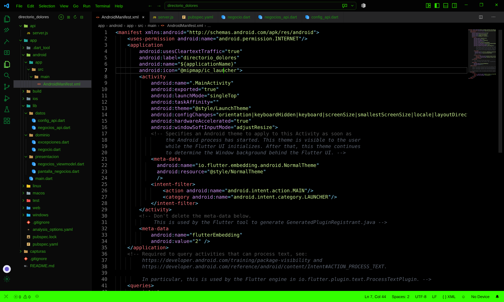
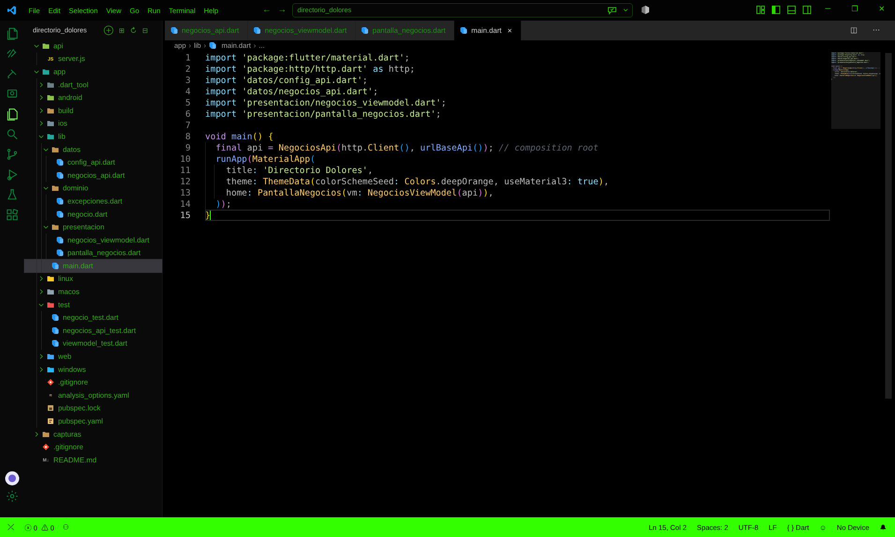
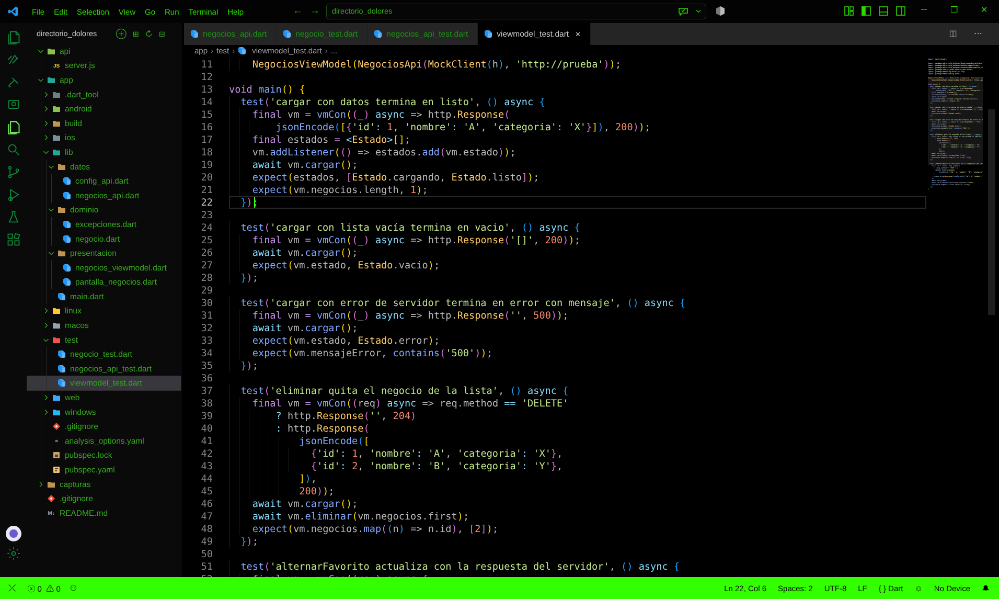
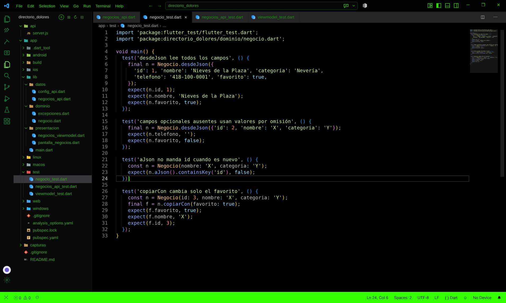

# 🏪 Directorio Dolorense — Consumo de una API local

App en Flutter, hecha con **TDD**, que consume una **API REST local hecha en Node**. Es un directorio de negocios de Dolores Hidalgo: la API guarda la lista y la app la **consulta, agrega, marca favoritos y elimina**. Todo funciona en la red Wi-Fi, sin pagar servidores.

- **Materia:** Desarrollo Móvil Integral · UTNG
- **Profesor:** Anastacio Rodríguez García
- **Alumna:** Yaneli Sánchez Cárdenas · Grupo GTID244

---

## 🍽️ La idea en una frase
La **app** es el cliente en la mesa, el **cliente HTTP** es el mesero y la **API** es la cocina. La app nunca entra a la cocina: solo pide en un formato que el mesero entiende (JSON).

| Verbo | Ruta | Qué hace | Respuesta |
|---|---|---|---|
| GET | `/negocios` | Lista (acepta `?q=` para buscar) | 200 |
| GET | `/negocios/3` | Un negocio | 200 / 404 |
| POST | `/negocios` | Crea uno | 201 / 400 |
| PUT | `/negocios/3` | Actualiza (favorito) | 200 / 404 |
| DELETE | `/negocios/3` | Elimina | 204 / 404 |
| GET | `/salud` | Revisa que la API esté viva | 200 |

---

## 📋 ¿Qué se hizo? (resumen por ronda)

| Ronda | Qué se construyó | Archivo(s) |
|---|---|---|
| 1 | API REST en Node **sin dependencias**: lista en memoria, JSON, CORS, validación (400) y escucha en `0.0.0.0` | `api/server.js` |
| 2 | Modelo `Negocio` con traductor JSON en las dos direcciones (`desdeJson` / `aJson`) y excepciones con nombre propio | `negocio.dart`, `excepciones.dart` |
| 3 | Cliente HTTP `NegociosApi` con el `http.Client` inyectado y probado con **MockClient** (sin red ni servidor): listar, crear, eliminar, error 500, sin red, timeout y JSON roto | `negocios_api.dart` |
| 4 | URL según la plataforma (`10.0.2.2` en emulador, `localhost` o la IP de la PC con `--dart-define`) y permiso de HTTP en Android | `config_api.dart`, `AndroidManifest.xml` |
| 5 | ViewModel con **5 estados**: inicial, cargando, listo, vacío y error | `negocios_viewmodel.dart` |
| 6 | Pantalla con `switch` de los 5 estados, jalar para recargar, deslizar para borrar, estrella de favorito, botón + y botón Reintentar | `pantalla_negocios.dart`, `main.dart` |

### Ciclo TDD
🔴 **ROJO:** prueba primero (falla) → 🟢 **VERDE:** código mínimo → 🔵 **REFACTOR:** ordenar sin romper nada.

### Estructura
```
directorio_dolores/
  api/
    server.js            <- la "cocina": API en Node
  app/
    lib/
      dominio/           <- Negocio y excepciones (Dart puro)
      datos/             <- cliente HTTP y configuración de URL
      presentacion/      <- ViewModel y pantalla
      main.dart
    test/                <- 17 pruebas (negocio, cliente HTTP, viewmodel)
```

---

## ▶️ Cómo ejecutarlo

**Terminal 1 · la API**
```bash
cd api
node server.js
```
Debe decir: `API lista en http://localhost:3000/negocios`. Déjala abierta.

**Terminal 2 · la app**
```bash
cd app
flutter pub get
flutter test
flutter run
```

En un **celular real** (misma red Wi-Fi que la PC):
```bash
flutter run --dart-define=API_URL=http://IP-DE-TU-PC:3000
```

### Prueba de fuego
1. Marca una ⭐ (PUT), agrega un negocio con ➕ (POST) y desliza uno para borrarlo (DELETE). La terminal de la API imprime cada petición.
2. Apaga la API (`Ctrl+C`) y jala para recargar: sale el mensaje de falta de conexión con el botón **Reintentar**.
3. Enciende la API otra vez y toca **Reintentar**: la lista regresa.

### Solución de problemas
| Problema | Causa |
|---|---|
| "Connection refused" en el emulador | Se usó `localhost` en lugar de `10.0.2.2` |
| Funciona en emulador pero no en celular | Redes distintas o el firewall bloquea el puerto 3000 |
| "Cleartext HTTP traffic not permitted" | Falta `usesCleartextTraffic` en el manifiesto |
| Tarda y luego sale "sin conexión" | La API no está encendida o cambió la IP |
| Lista vacía sin error | Se reinició la API: los datos viven en memoria |

---

## 📸 Evidencias

### API en Node

**C1 · `responder()`: siempre JSON + cabeceras CORS**


**C2 · Las rutas REST: GET, POST, PUT y DELETE con sus códigos**


**C3 · Escuchar en `0.0.0.0` para que entre el celular**


### App Flutter

**C4 · `pubspec.yaml`: se agrega el paquete http**


**C5 · Traductor JSON ↔ objeto `Negocio`**


**C6 · Excepciones con nombre propio y mensaje claro**


**C7 · `_ejecutar()`: timeout, errores de red y statusCode en un solo lugar**


**C8 · `listar()`: GET /negocios y JSON → lista de objetos**


**C9 · URL según la plataforma (10.0.2.2, localhost o la IP de la PC)**


**C10 · `AndroidManifest.xml`: permiso de internet y HTTP sin candado (solo desarrollo)**


**C11 · Los 5 estados de la pantalla**


**C12 · `cargar()`: cargando → listo / vacío / error**


**C13 · La pantalla dibuja cada uno de los 5 estados con `switch`**


**C14 · `main.dart`: se arma todo con la URL correcta**


### Pruebas

**P1 · MockClient revisa el método, la ruta y la respuesta**


**P2 · Un servidor lento se trata como "sin conexión"**


**P3 · Se prueba el viaje de estados: `[cargando, listo]`**


**P4 · Un negocio nuevo no manda `id` al servidor**


---

## ✅ Checklist de calidad
- [x] La URL base no está escrita "a fuego": se configura por plataforma y con `--dart-define`.
- [x] Todos los fallos técnicos se traducen a excepciones con mensajes comprensibles.
- [x] Hay timeout en cada petición.
- [x] Se revisa el `statusCode`: un 404 o 500 nunca se trata como datos.
- [x] Las pruebas usan MockClient: no dependen de red ni de servidor.
- [x] La pantalla cubre los cinco estados.
- [x] El tráfico HTTP sin cifrar está habilitado **solo para desarrollo**.
